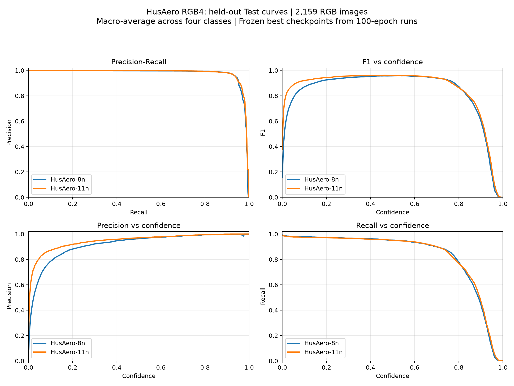
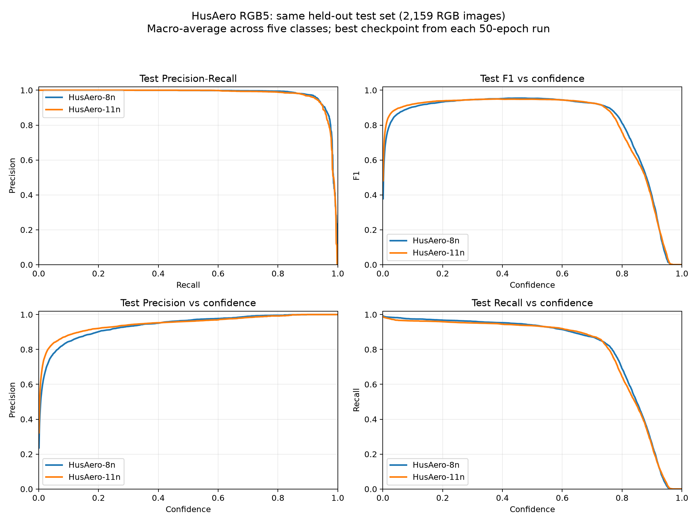

# HusAero — Vision-Based Drone Detection and Tracking

Final Year Project by **Hussain Alrashidi (27kwt)**. The system uses a visible-light camera, **Raspberry Pi 5 and Hailo-8 (26 TOPS)**, with pan-tilt control to keep a detected drone in view. HusAero-8n and HusAero-11n are fine-tuned Ultralytics YOLOv8n and YOLO11n models. [Sources and attribution](NOTICE.md)

## Start here

| What to view | Location |
| --- | --- |
| One organized dataset: images, labels and configuration | [dataset](dataset/) |
| Current four-class trained checkpoints | [models/rgb4](models/rgb4/) |
| Current 100-epoch training, validation tables and plots | [results/rgb4](results/rgb4/) |
| Current RGB4 Test scores, curves and confusion matrices | [Test results](results/rgb4/test_20261117/) |
| Current RGB4 recorded-video Raspberry Pi evidence | [Pi comparison](results/rgb4/pi_recorded_video_20261114/) |
| Earlier RGB5 Test results and Raspberry Pi evidence | [results/rgb5_v2](results/rgb5_v2/) |
| One-page English Test report for the supervisor | [PDF](docs/HusAero_RGB5_Test_Results_One_Page_English.pdf) |
| Earlier versions and reproducibility | [archive](archive/README.md) |

## Current project status

The current dataset and PT checkpoints use **four classes: drone, bird, airplane and helicopter**. Fixed-wing and multirotor drones share the `drone` category. This system does not identify drone subtypes, payloads or missions.

| Stage | Status |
| --- | --- |
| Dataset: 13,954 train / 3,423 validation / 2,159 Test images | Prepared; images and labels audited |
| RGB4 HusAero-8n training | 100/100 epochs completed |
| RGB4 HusAero-11n training | 100/100 epochs completed |
| RGB4 validation and plots | Available below |
| RGB4 PT files on GitHub | Uploaded; both checkpoint fingerprints verified |
| RGB4 held-out Test evaluation | Completed: 2,159 images per model; curves and audit available |
| RGB4 Hailo-8 compilation | Both HEFs compiled; fingerprint chain verified |
| RGB4 recorded-video Pi/Hailo run | 300 frames per model; operational evidence available |
| RGB4 HEF accuracy on the labelled Test partition | Pending |
| Live-camera pan-tilt system validation | Pending |

## Current RGB4 Test results — 17 November 2026

| Model | Precision | Recall | Mean F1 | mAP50 | mAP50-95 |
|---|---:|---:|---:|---:|---:|
| HusAero-8n | 96.70% | 95.04% | 95.85% | 97.69% | 73.40% |
| HusAero-11n | 96.75% | 95.52% | 96.13% | 97.99% | 72.91% |

Both frozen best checkpoints were evaluated once on the same **2,159 Test images** (2,923 objects), with input size 640 and an RTX 4090. No training was performed. P/R and mean class F1 use each model's native mean-F1 reporting point; they are not fixed-threshold deployment metrics. The Test images were previously used by the older RGB5 benchmark; this is not a new independent external dataset.



[Full Test results, drone-only curves and numerical data](results/rgb4/test_20261117/) · [Dataset and result checks](results/rgb4/test_20261117/results_audit.json)

The scores are close: 11n is slightly higher on AP50, while 8n is higher on mAP50-95. These PC scores do not establish Hailo HEF accuracy or live-camera tracking performance.

## Current RGB4 validation

| Model | Precision | Recall | mAP@50 | mAP@50–95 |
| --- | ---: | ---: | ---: | ---: |
| HusAero-8n | 94.70% | 91.14% | 94.77% | 67.82% |
| HusAero-11n | 94.48% | 90.74% | 94.67% | 67.82% |

These are best-checkpoint results on **3,423 validation images**, not Test or Raspberry Pi results. [View the training curves and exact metrics](results/rgb4/).

## Preserved RGB5 experiments

The earlier five-class experiments separated fixed-wing and multirotor drones. Both models completed 50 epochs and were evaluated on all 2,159 Test images on PC. Their model files, Test curves and recorded Pi experiments remain available with their original class maps.

| Earlier model | Test precision | Test recall | Test mAP@50 | Test mAP@50–95 |
| --- | ---: | ---: | ---: | ---: |
| RGB5 HusAero-8n | 96.25% | 94.72% | 97.89% | 71.57% |
| RGB5 HusAero-11n | 95.31% | 94.41% | 97.58% | 71.67% |



[English one-page Test report](docs/HusAero_RGB5_Test_Results_One_Page_English.pdf) · [Original Test and Pi evidence](results/rgb5_v2/) · [Verified RGB5 Pi runtime](results/rgb5_v2/runtime_fix_v2/)

RGB4 and RGB5 use different class definitions, and the validation/Test tables use different partitions where indicated; their aggregate scores cannot establish whether RGB4 improved on RGB5. Both earlier models confused drone subtypes in a reviewed video. Recorded-file Pi timings do not establish live-camera latency, and flow-assisted boxes are not fresh detector observations.

## Use the current model on a PC

Both verified RGB4 PT checkpoints are included in `models/rgb4/`. The registry records their SHA-256 fingerprints. Use Python 3.11 and the pinned [requirements](requirements.txt). On Windows, `setup_cpu.cmd` prepares the environment; `run_demo.cmd` runs the current 8n model on the small demonstration images. For a photo or video:

```sh
python demo.py --model HusAero-8n --source path/to/input.jpg
```

To verify the full dataset without starting training:

```sh
python tools/prepare_current_dataset.py
```

The dataset is already in `dataset/images` and `dataset/labels`. No nested RGB4/RGB5 preparation folders or hard links are required. Demonstration images are not a benchmark. Both RGB4 HEFs have been compiled locally; see the [compilation evidence](results/rgb4/hailo8_compilation_20261114/) and [recorded-video Pi run](results/rgb4/pi_recorded_video_20261114/). HEF binaries remain in the local RGB4 deployment bundle. The [RGB5 runtime guide](models/rgb5_v2/README.md) describes the earlier five-class experiment.

## Data and interpretation

Source photos come from four public datasets; they are not presented as our own camera recordings. See [source details and limits](dataset/provenance/DATA_CARD.md) and [image licenses](dataset/provenance/LICENSE_DATA.md). VisioDECT material retains the recorded noncommercial/share-alike terms. Source groups and exact duplicates are checked, but complete source-session independence remains unverified. The two starting checkpoints also have different prior histories.
