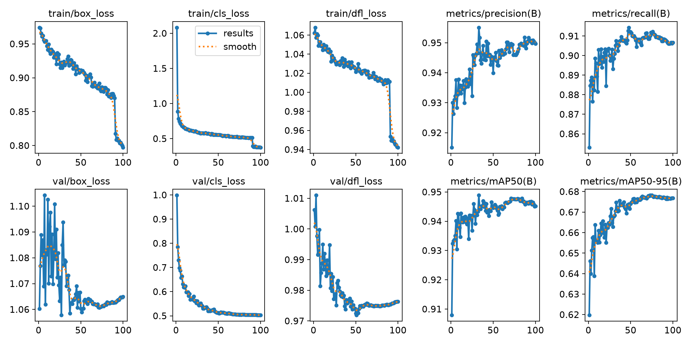
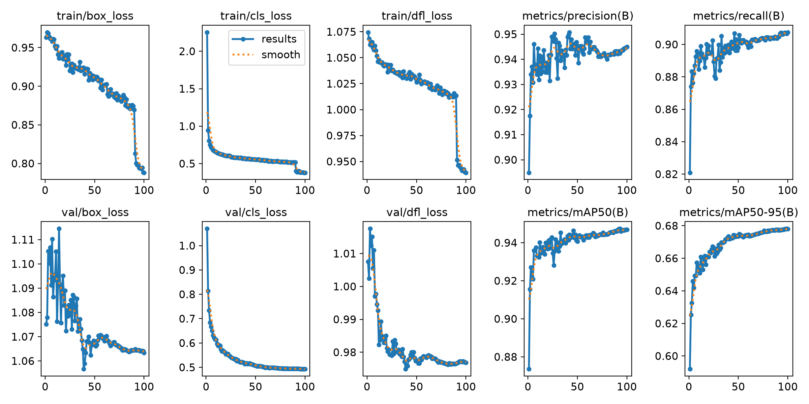

# RGB4 training and validation — 14 November 2026

Both models completed **100 epochs** using 13,954 training images and 3,423 validation images. Input size: 640; batch: 32; SGD; initial learning rate: 0.001; seed: 42; training GPU: RTX 4090. The recorded environment used Ultralytics 8.4.201 and PyTorch 2.11.0+cu128.

| Model | Precision | Recall | mAP@50 | mAP@50–95 |
| --- | ---: | ---: | ---: | ---: |
| HusAero-8n | 94.70% | 91.14% | 94.77% | 67.82% |
| HusAero-11n | 94.48% | 90.74% | 94.67% | 67.82% |

These are the recorded best-checkpoint **validation** metrics. They are not Test results, live-camera accuracy, tracking performance or Raspberry Pi throughput. The small difference does not establish an architecture winner; both candidates still need the same held-out Test and hardware evaluation.

## Curves

### HusAero-8n

### HusAero-11n

Each model folder also contains precision/recall and confusion-matrix figures, `results.csv` and the recorded training arguments. [Exact metrics](validation_summary.json) · [Current checkpoints](../../models/rgb4/)

## Provenance and limits

The `provenance` folder preserves sanitized run state, preflight details and source-script snapshots. Machine-specific paths are replaced with `<PROJECT_ROOT>` or `<RUN_ROOT>`; historical relative paths remain as recorded. These snapshots describe the completed run and are not current launch commands. A callback recorded epoch 101 at completion; each metrics CSV contains exactly 100 completed epochs. The preflight report describes the state before training, not today's status.

The split and image/label bytes are unchanged by the 15 November folder cleanup. Source groups and exact duplicates were checked, but complete independence of all original recording sessions is not established. These source limitations apply when interpreting the scores.

Next steps: evaluate the two selected RGB4 checkpoints on the reserved 2,159 Test images, export and compile for Hailo-8, then measure performance on the Raspberry Pi 5 and camera/pan-tilt setup. None of those RGB4 results is claimed here.
