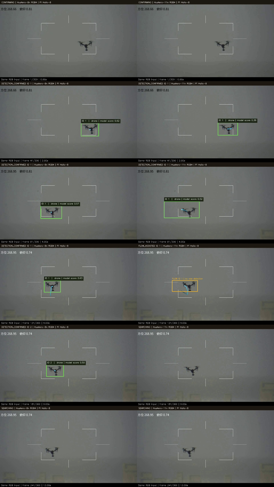

# RGB4 recorded-video Raspberry Pi / Hailo-8 comparison

This experiment was completed on 14 November 2026 and added to the evidence index on 17 November. Both current RGB4 HEFs processed the same 300 sequential frames from one recorded visible-light video on Raspberry Pi 5 + Hailo-8 (26 TOPS). No new hardware run is claimed by this publication.

| Model | Frames | Fresh raw-detection frames | Flow-assisted states | Mean inference | Recorded-file processing |
|---|---:|---:|---:|---:|---:|
| HusAero-8n | 300 | 185 | 79 | 10.19 ms | 47.68 FPS |
| HusAero-11n | 300 | 97 | 83 | 15.10 ms | 39.82 FPS |

The source is 20 FPS. Processing FPS measures recorded-file execution and does not establish live-camera throughput or camera-to-display latency. Counts are operational observations, not accuracy, recall or mAP. The video has no annotated localization evaluation; flow-assisted boxes are predictions between detector observations. This is a development clip, not an independent holdout.

[Summary](summary.json) · [Coverage and hash audit](audit.json) · [8n frame records](HusAero-8n.jsonl) · [11n frame records](HusAero-11n.jsonl)

