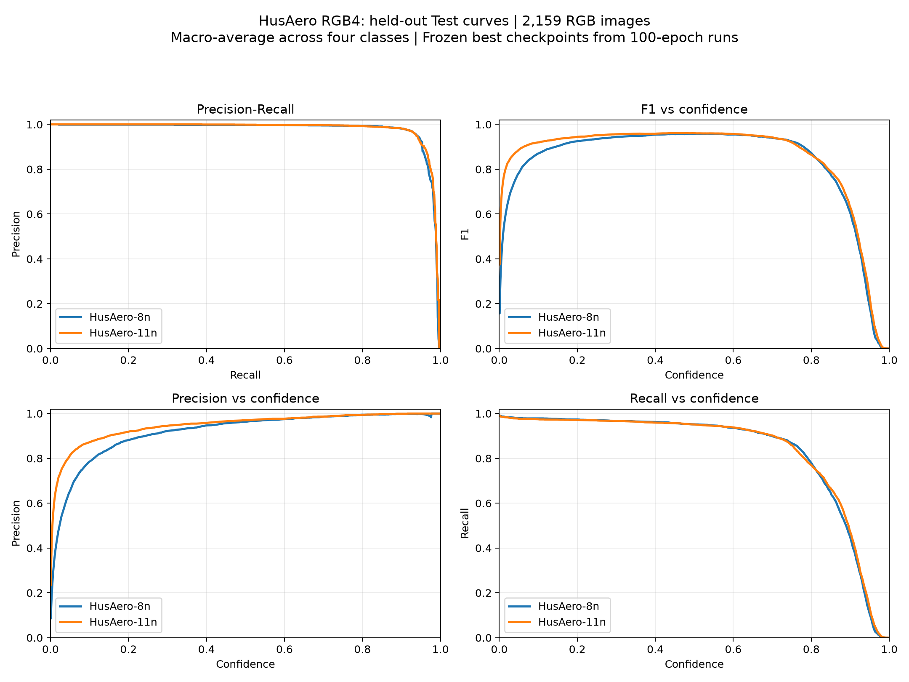
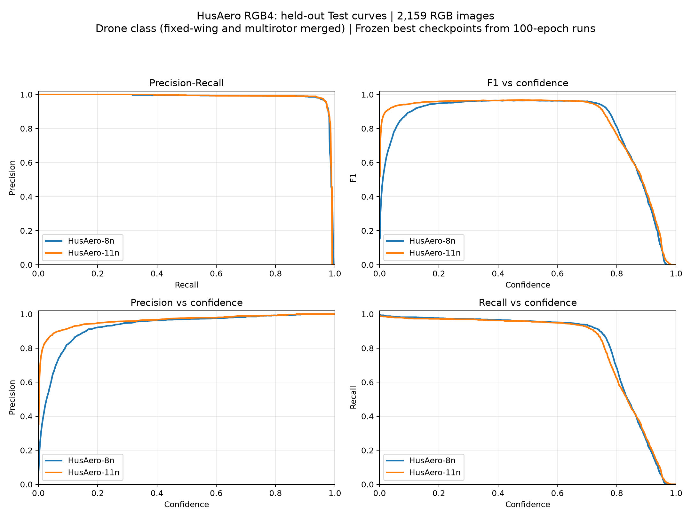

# HusAero RGB4 held-out Test results

Both frozen best checkpoints from the completed 100-epoch runs were evaluated once on the same 2,159 RGB Test images (2,923 labelled objects). No training or weight changes were performed.

| Model | Precision | Recall | mAP50 | mAP50-95 |
|---|---:|---:|---:|---:|
| HusAero-8n | 96.70% | 95.04% | 97.69% | 73.40% |
| HusAero-11n | 96.75% | 95.52% | 97.99% | 72.91% |

## Drone class

| Model | Precision | Recall | AP50 | AP50-95 |
|---|---:|---:|---:|---:|
| HusAero-8n | 97.19% | 95.72% | 98.25% | 66.76% |
| HusAero-11n | 97.48% | 96.00% | 98.35% | 64.06% |

## Test curves

The curves show Test detection performance across confidence thresholds; they are not training/validation curves over epochs. F1 is the harmonic mean of precision and recall. Precision-Recall curves use IoU 0.50 matching. AP50-95 averages AP at IoU thresholds from 0.50 to 0.95.

Each model folder also contains per-class curves, confusion matrices, numerical curve CSV files, raw detection statistics, prediction JSON and evaluation coverage checks. The native confusion matrix uses confidence 0.001 and matching IoU 0.45. It includes low-confidence detections and is not the P/R reporting or deployment operating point. Rows are predicted classes; columns are ground truth; the final row/column is background.

## F1 and interpretation

| Model | Mean class F1 | Drone F1 |
|---|---:|---:|
| HusAero-8n | 95.85% | 96.45% |
| HusAero-11n | 96.13% | 96.74% |

F1 values are taken at the same native mean-F1 reporting point used for each model's precision/recall. Mean class F1 is the average of four class F1 scores, not the harmonic mean of the two aggregate P/R values. The saved reporting thresholds describe this benchmark and are not recommendations for deployment.

The results are close. HusAero-11n has slightly higher recall and AP50; HusAero-8n has higher mAP50-95 overall and higher drone AP50-95 (66.76% vs 64.06%). This indicates stronger box localization under stricter matching in this dataset for 8n, but does not establish statistical superiority or field reliability. Retain both candidates for independent video and live-camera evaluation.

## Scope and limitations

- This is a PC PyTorch checkpoint accuracy evaluation, not a new Hailo HEF accuracy or live-camera/Pan-Tilt test.
- Both RGB4 HEFs and a separate 300-frame-per-model recorded-video Pi/Hailo comparison already exist; their results are separate.
- The four-class Test partition reuses public-data images previously evaluated under RGB5 labels. It is not a new independent external dataset.
- No manifest group or exact image hash crosses partitions; complete source recording-session independence is not established.
- Starting checkpoints have different prior training histories. Differences are not an architecture-only causal comparison.
- Precision/recall use each model's smoothed maximum mean-F1 reporting point. These values do not select a deployment threshold.
- The drone class merges fixed-wing and multirotor. These metrics do not measure drone subtype recognition.
- Four-class RGB4 metrics should not be directly compared with old five-class RGB5 aggregates.
- Reported inference timing is batched desktop GPU processing, not camera-to-display latency or Raspberry Pi speed.

The numerical prediction JSON uses category IDs 1=drone, 2=bird, 3=airplane and 4=helicopter; YOLO labels use IDs 0–3. Absolute machine paths in published JSON have been replaced with placeholders. The isolated evaluation copies are not duplicated in GitHub; the original Test files remain under `dataset/images/test` and `dataset/labels/test`.
