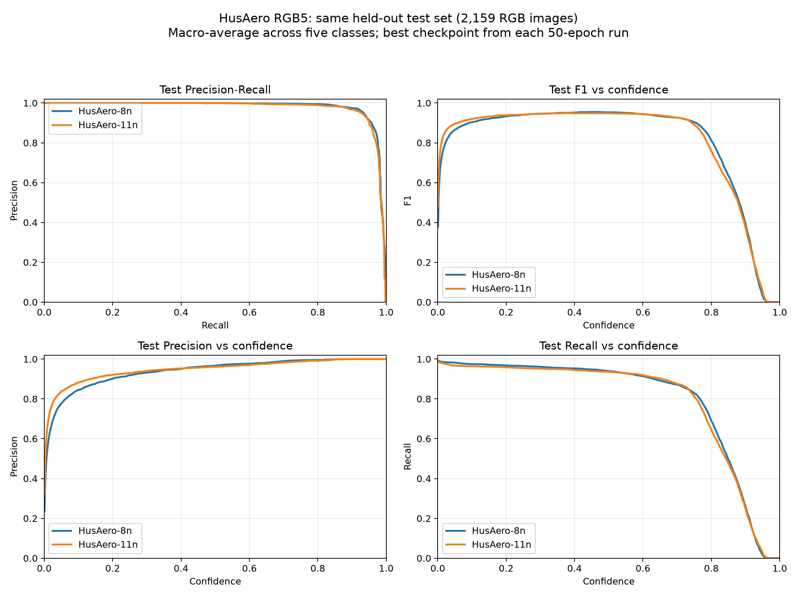

# RGB5 v2: completed PC image test

Fresh held-out evaluation of both best checkpoints from 50-epoch experiments on **all 2,159 test images**, 640-pixel input, RTX 4090. This is not Raspberry Pi/Hailo performance.

| Model | Precision | Recall | mAP50 | mAP50-95 | Mean drone AP50 |
| --- | ---: | ---: | ---: | ---: | ---: |
| HusAero-8n | 96.25% | 94.72% | 97.89% | 71.57% | 98.21% |
| HusAero-11n | 95.31% | 94.41% | 97.58% | 71.67% | 97.32% |

8n leads most of these metrics, including mean AP50 of the two drone classes; 11n leads mAP50-95 by about 0.10 percentage point. The differences do not establish an overall field-performance winner.

Each model folder contains test curves, confusion matrices, predictions, metric JSON and CSV curve values. Training_reference contains the actual original per-epoch training/validation graph and CSV, separately labelled. Test curves vary confidence thresholds; they are not per-epoch test losses. Reported mAP uses Ultralytics' native evaluation; the optional COCO evaluator has a different max-detections protocol. Precision/recall use the best mean-F1 operating point, not fixed confidence 0.25. Mean drone AP50 averages the two drone-class AP50 values, not merged-class AP.

Current RGB5 video check: **one unique unannotated RGB clip, 200 frames per model**, basic centre association. These operation counts are not tracking accuracy. Both candidates misclassified a visible multirotor as fixed-wing in a reviewed frame. Earlier 18-clip results elsewhere belong to the previous model release and are not extra RGB5 clips.

Both compiled Hailo-8 models were verified on Raspberry Pi with a 500-image stratified test-only sample; see [Pi_sample500](Pi_sample500/). This actual sample is separate from the full 2,159-image native PC test above. A complete-dataset Pi run reports training, validation and test separately; no unreturned result is claimed. Complete source recording-session independence is not established; prior checkpoint histories differ.
